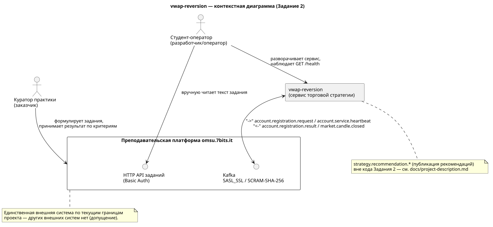
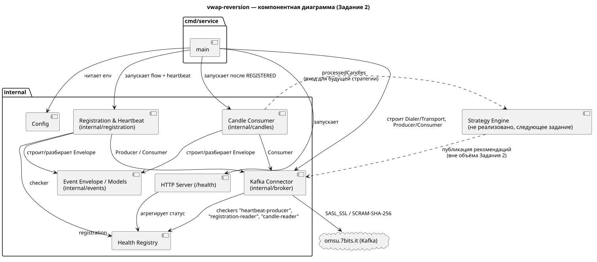

# Проектный документ: vwap-reversion

**Последняя ревизия:** 2026-10-17 (Задание 2: Kafka-интеграция)

## Замысел

`vwap-reversion` — сервис торговой стратегии, который подключается к учебной
платформе `omsu.7bits.it`, получает рыночные данные и публикует торговые
рекомендации. В рамках Задания 1 реализован каркас сервиса и эндпоинт
проверки состояния `GET /health`. В рамках Задания 2 (`semester-1-broker`)
реализована Kafka-интеграция: регистрация сервиса на платформе
(`account.registration.request/result`), периодический heartbeat
(`account.service.heartbeat`) и приём рыночных свечей
(`market.candle.closed`). Сама логика стратегии (расчёт VWAP и публикация
рекомендаций `strategy.recommendation.*`) — в последующих заданиях.

## Торговая идея (допущение)

Возврат к VWAP (volume-weighted average price): сервис отслеживает отклонение
текущей цены от скользящего VWAP за окно свечей и формирует рекомендацию в
духе "цена заметно выше VWAP — продавать/держать в ожидании возврата, заметно
ниже — покупать/держать в ожидании роста". Выбрана нишевая идея (не momentum),
чтобы не пересекаться со стратегиями одногруппников. Конкретные параметры
(окно расчёта VWAP, порог отклонения) не определены на этом этапе —
зафиксировано как открытый вопрос ниже.

## Проблема, цели, задачи

**Проблема.** Нужен учебный сервис, который по рыночным данным формирует
простую, объяснимую торговую рекомендацию и может быть подключён к
преподавательской платформе как независимый участник.

**Цели.**
- Спроектировать и выпустить рабочий каркас серверного приложения, готовый к
  расширению под Kafka-интеграцию без переписывания слоёв.
- Обеспечить наблюдаемость через единый эндпоинт проверки состояния.

**Задачи.**
- Зафиксировать границы, роли и инструменты проекта в этом документе.
- Реализовать `GET /health` без авторизации с форматом ответа по заданию.
- Обеспечить сборку и запуск без среды разработки (CLI + Docker).
- Обеспечить корректное завершение процесса по сигналу (graceful shutdown).

**Ожидаемый результат.** В Git-репозитории лежат этот проектный документ,
исходный код каркаса сервиса, `Dockerfile` и `README.md` с командами сборки
и запуска; сервис собирается одной командой без среды разработки, а
`GET /health` отвечает по формату задания.

## Границы

**Входит в сервис:**
- HTTP-сервер и слой конфигурации (`internal/httpserver`, `internal/config`).
- Подсистема проверки состояния (`internal/health`) и её расширяемый интерфейс
  `Checker`, теперь используемый четырьмя реализациями: `registration`
  (`internal/registration`) и `heartbeat-producer`/`registration-reader`/
  `candle-reader` (`internal/broker`).
- Kafka-клиент (`internal/broker`): SASL_SSL/SCRAM-SHA-256,
  producer/consumer с ручным commit, retry+backoff на транзиентных ошибках.
- Модели событий и обёртка-конверт (`internal/events`).
- Регистрация сервиса на платформе и heartbeat (`internal/registration`).
- Приём рыночных свечей `market.candle.closed` со структурным логированием
  (`internal/candles`).
- Процесс сборки, контейнеризация, конфигурация через переменные окружения.

**Не входит в сервис (сейчас):**
- Сама логика торговой стратегии (расчёт VWAP, принятие решений) и
  публикация `strategy.recommendation.*` (включая `HOLD`) — отдельная
  задача, не код Задания 2.
- Подключение реальной БД — `components` в ответе `/health` всё ещё не
  включает БД-чекер.
- Любой auth-middleware — в проекте его пока нет; правило на будущее:
  `/health` обязан оставаться исключённым из авторизации (зафиксировано в
  `internal/httpserver/server.go`, функция
  `registerRoutesExemptFromFutureAuthMiddleware`).
- Пользовательский интерфейс.

**Что контролирует сервис:** собственный процесс, HTTP-порт, формат ответа
`/health`, конфигурацию через env. Не контролирует: учётные данные платформы
`omsu.7bits.it`, расписание и состав учебных заданий.

**Внешние системы (на уровне проекта):**
- Преподавательская платформа `omsu.7bits.it` — единственная внешняя
  система по текущим границам проекта (пустой список прочих внешних систем —
  явное допущение, не недосмотр). Два интерфейса: HTTP API заданий
  (`GET /api/public/practice-assignments`, Basic Auth) и Kafka
  (SASL_SSL/SCRAM-SHA-256: `account.registration.*`,
  `account.service.heartbeat`, `market.candle.closed`,
  `strategy.recommendation.*`).

## Внешние системы: входы/выходы (детально)

| Система | Направление | Протокол | Данные | Аутентификация | Статус |
|---|---|---|---|---|---|
| Клиент `/health` (любой, включая платформу-оркестратор) | вход | HTTP/JSON | запрос без тела | без авторизации (явно по заданию) | реализовано |
| `omsu.7bits.it` (задания) | вход (ручное чтение) | HTTPS/JSON | текст задания | логин/пароль, в `.env` | вне кода сервиса |
| `omsu.7bits.it` (регистрация) | выход → вход | Kafka `account.registration.request` → `account.registration.result` | `secretKey, accountId, accountName, groupId, strategyId, strategyName, serviceName, description?` → `status (REGISTERED/REJECTED), reason` | SASL_SSL/SCRAM-SHA-256 | реализовано |
| `omsu.7bits.it` (heartbeat) | выход | Kafka `account.service.heartbeat`, ~5 с | `secretKey, accountId, groupId, strategyId, serviceName, instanceId, status, startedAt, sentAt, processedCandles, publishedRecommendations, lastProcessedSequenceNumber, metadata` | SASL_SSL/SCRAM-SHA-256 | реализовано |
| `omsu.7bits.it` (свечи) | вход | Kafka `market.candle.closed` | `runId, groupId, instrument{ticker, figi, currency, lotSize}, timeframe, sequenceNumber, candleTime, tradingDate, sessionPhase, open/high/low/close (decimal-строки), volume, isWarmup` | SASL_SSL/SCRAM-SHA-256 | реализовано (только приём и структурный лог) |
| `omsu.7bits.it` (рекомендации) | выход | Kafka `strategy.recommendation.*` | рекомендация (`HOLD` и т.д.) | SASL_SSL/SCRAM-SHA-256 | **вне объёма Задания 2** — отдельная задача в трекере |

Контракт событий Kafka задокументирован в `internal/events` (обёртка
`Envelope` + 4 payload-модели); закрывает открытый вопрос №2 из Задания 1.

## Компоненты

| Компонент | Назначение | Зона ответственности | Статус |
|---|---|---|---|
| HTTP-сервер (`internal/httpserver`) | Приём HTTP-запросов, роутинг, таймауты | Регистрация маршрутов, graceful shutdown | реализован |
| Health-подсистема (`internal/health`) | Агрегация статуса сервиса и его зависимостей | Интерфейс `Checker`, правило агрегации статуса | реализован, 4 checker'а (`registration`, `heartbeat-producer`, `registration-reader`, `candle-reader`) |
| Конфигурация (`internal/config`) | Чтение параметров среды | `PORT`, `SERVICE_NAME`, `SERVICE_VERSION`, Kafka- и account-переменные | реализован, `Load() (Config, error)` без `os.Exit` внутри |
| Event Envelope / Models (`internal/events`) | Общий конверт события и 4 payload-модели | UUIDv4 на `crypto/rand`, decimal-поля свечи как строки | реализован |
| Kafka Connector (`internal/broker`) | Транспорт к `omsu.7bits.it:9094` | `kafka.Dialer`/`kafka.Transport` с SASL SCRAM-SHA-256, producer/consumer с ручным commit, retry+backoff, health-чекеры | реализован (`github.com/segmentio/kafka-go`, без cgo) |
| Registration & Heartbeat (`internal/registration`) | Регистрация сервиса, heartbeat | Flow читателя→publish→матчинг ответа, тикер ~5 с | реализован |
| Candle Consumer (`internal/candles`) | Приём `market.candle.closed` | Структурный лог, состояние по `runId+ticker` | реализован |
| Strategy Engine | Расчёт VWAP, публикация рекомендаций | — | **предусмотрено, не реализовано** — следующее задание |
| БД | Хранение состояния стратегии/истории | — | **предусмотрено, не реализовано** в этой итерации |

## Схемы

Контекстная диаграмма (сервис, пользователи, единственная внешняя система
`omsu.7bits.it` с двумя интерфейсами):



Компонентная диаграмма (крупные узлы сервиса, включая плейсхолдер
нереализованного Strategy Engine):



Исходники — `docs/diagrams/context.puml` и `docs/diagrams/components.puml`.
Ререндер после правки `.puml`:

```
docker run --rm -v "$PWD/docs/diagrams:/work" plantuml/plantuml -tsvg /work/context.puml /work/components.puml
```

`.svg` коммитится рядом с `.puml` и открывается в GitHub без установки
PlantUML. Автоматической CI-проверки расхождения `.puml`/`.svg` нет — риск
забытого ререндера принят, не закрыт.

## Роли

- **Куратор практики (заказчик)** — формулирует задание на `omsu.7bits.it`,
  принимает результат по критериям приёмки.
- **Разработчик-студент (он же оператор)** — проектирует, реализует, собирает,
  запускает и поддерживает сервис локально; единственный человек в проекте на
  этом этапе.
- **Владелец платформы `omsu.7bits.it`** — отвечает за внешний API заданий и
  (в будущих заданиях) за контракт событий регистрации/обмена данными.

Шаблонные роли (PM, QA, SRE, DBA и т.п.) не введены — в учебном
одноразработческом проекте они не нужны.

## Инструменты (с обоснованием)

| Инструмент | Выбор | Почему этот, а не альтернатива |
|---|---|---|
| Git-хостинг | GitHub | Бесплатный, привычный, интеграция с GitHub Actions без доп. настройки инфраструктуры. |
| Язык и каркас | Go + `net/http` (stdlib) | Для одного эндпоинта `/health` и будущего небольшого числа маршрутов полноценный фреймворк (`chi`, `gin`) — лишняя зависимость и лишний слой абстракции; stdlib `net/http` даёт таймауты, `ServeMux` и `Server.Shutdown` без внешних пакетов, что упрощает Dockerfile (нет `go.sum` с чужим кодом) и снижает поверхность атаки. |
| Контейнеризация | Docker (multi-stage: `golang:1.26-alpine` → `alpine:3.20`) | Multi-stage убирает тулчейн из финального образа; `alpine`, а не `scratch`, выбран ради CA-сертификатов — в Задании 2 они действительно нужны TLS-подключению к Kafka (SASL_SSL), что подтверждает решение Задания 1. |
| Тестирование | `go test` (stdlib) + `net/http/httptest` | Встроено в Go, не требует отдельного test-runner'а; `httptest` достаточен для проверки HTTP-хендлеров без поднятия реального сокета. Kafka-зависимый код (`internal/broker`, `internal/registration`, `internal/candles`) тестируется через DI-интерфейсы (fake Producer/Consumer), без сети. |
| CI (план, не настроено) | GitHub Actions | Нативная интеграция с GitHub-хостингом репозитория; конкретный workflow-файл — вне объёма Задания 1 и Задания 2. |
| Трекер задач (план, не выбран окончательно) | GitHub Issues | Привязан к тому же репозиторию, не требует отдельного сервиса для одного разработчика. |
| Документация | Markdown в репозитории (`docs/`, `README.md`) | Версионируется вместе с кодом, не требует отдельного вики-движка. |
| БД (пока не выбрана) | Решение отложено | `components` в `/health` пока не включает БД-чекер; выбор (Postgres/SQLite/иное) привязан к задаче хранения состояния стратегии в будущем задании, делать его раньше рано. |
| Брокер сообщений | Kafka | Выбор задан платформой `omsu.7bits.it` (события `account.registration.*`, `account.service.heartbeat`, `market.candle.closed`) — не альтернатива, а внешнее требование. В Задании 2 реализован клиентом **`github.com/segmentio/kafka-go`** — pure Go без cgo/librdkafka, в отличие от `confluent-kafka-go`. Выбор принципиален для multi-stage Alpine-сборки: `confluent-kafka-go` тянет `librdkafka-dev`/`gcc` в builder и `librdkafka.so` в runtime, что либо ломает `CGO_ENABLED=0`, либо требует Alpine-специфичных dev-пакетов и усложняет Dockerfile; `kafka-go` даёт встроенный `sasl/scram` под SCRAM-SHA-256 и модель ручного commit (`enable.auto.commit=false`-эквивалент) без этой цены. |
| Среда разработки | Любая с поддержкой Go (не фиксируется) | Сборка и запуск не зависят от IDE (`go build`, `Docker`); конкретный редактор — личный выбор разработчика, не влияет на результат. |

## Допущения и открытые вопросы

1. **Допущение.** Имя сервиса — `vwap-reversion`, стратегия — возврат к VWAP.
   Параметры стратегии (окно, пороги) не определены.
2. ~~Открытый вопрос: формат `account.registration.*`~~ — **закрыт в Задании
   2.** Формат задокументирован в `internal/events` (`Envelope` +
   `RegistrationRequestPayload`/`RegistrationResultPayload`), топики — в
   `internal/config` (`TOPIC_REGISTRATION_REQUEST`/`_RESULT`).
3. **Открытый вопрос.** Источник поля `version` в финальной системе: сейчас
   статичный дефолт `0.1.0` из `SERVICE_VERSION`/кода; не определено, будет ли
   версия проставляться из CI/тега при релизе.
4. **Открытый вопрос.** Выбор БД под будущее задание со стратегией (какая БД,
   схема, нужен ли отдельный DB-checker в `/health`) — не решён.
5. **Открытый вопрос.** Итоговый трекер задач и состав CI-пайплайна
   (GitHub Issues/Actions предложены как план, не как принятое решение).
6. **Решение (сверх буквального текста задания).** Heartbeat
   (`account.service.heartbeat`, ~5 с) включён в объём, хотя не упомянут в
   буквальном тексте инструкций/acceptance Задания 2. Причина: без свежего
   heartbeat платформа быстро переводит сервис в `STALE`/`OFFLINE` в UI даже
   после успешной регистрации — это ломает наблюдаемость, которую сам
   `getting-started.md` платформы закладывает в типовой первый запуск.
   Стоимость низкая (тот же producer/envelope, что и для регистрации).
7. **Решение.** `KAFKA_GROUP_ID` — один env, код добавляет суффиксы
   (`.registration`, `.candles`) для разных `Reader` (`broker.GroupID`), чтобы
   каждый студент получал полный поток свечей/результатов регистрации, а не
   часть, при сохранении одного base-значения в конфигурации.
8. **Открытый вопрос.** Точный формат `status` в `account.service.heartbeat`
   (используется `"ONLINE"` по аналогии с типовым набором
   `ONLINE/STALE/OFFLINE` из UI платформы) — не подтверждён офлайн-доступом
   к документации платформы; см. `events.HeartbeatStatusOnline`.
9. **Открытый вопрос.** Реальные `secretKey`, Kafka-логин/пароль,
   `CANDLE_TOPIC`, `accountId`, учебные `groupId`/`strategyId` — выдаются
   преподавателем лично, публичного API получить их нет. Код, конфигурация и
   юнит-тесты не зависят от реальных значений (DI-фейки); живая проверка
   регистрации/приёма свечей на реальном брокере — отдельный ручной шаг.
